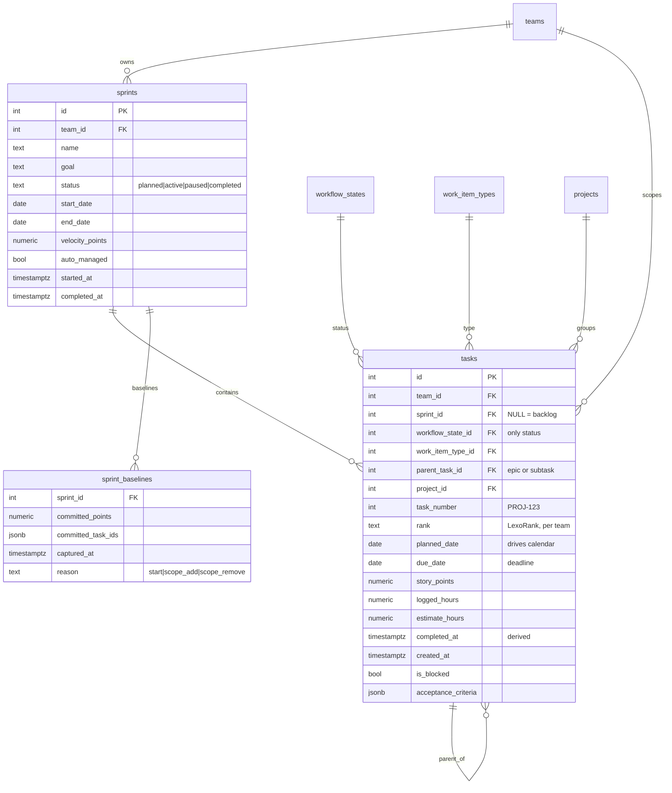
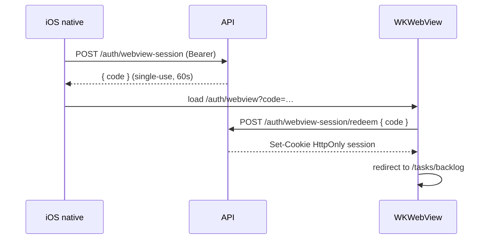

# WorkPulse Tasks — Backlog / Sprint / Schedule Design Spec

**Status:** approved design, not yet implemented
**Date:** 2026-10-25
**Scope:** the Tasks area (Backlog, Sprint, Schedule) of every WorkPulse client
**Parity matrix:** [`contracts/tasks-parity.json`](../contracts/tasks-parity.json)
**Parity gate:** `node scripts/validate-tasks-parity.mjs` (wired into `contracts:validate`)

This is the single source of truth for the Tasks domain model, information
architecture, per-view behaviour, API surface, and per-client parity. It follows
the convention established by [`CHAT_DESIGN_SPEC.md`](./CHAT_DESIGN_SPEC.md).

---

## 1. Problem statement

> "In the tasks backlog, if a ticket is completed, those completed items are also
> visible in the backlog."

That is a symptom of three defects, not one. All three are fixed by this spec.

| # | Defect | Evidence | Consequence |
|---|--------|----------|-------------|
| D1 | **Three competing "containers"** | `server/routes/tasks/backlog.ts:1,45-49` defines backlog as `date IS NULL AND sprint_id IS NULL` | Setting a planned date silently *removes* a task from the backlog. Backlog and Schedule compete for the same item. |
| D2 | **No completed filter or grouping** | Same query applies no status predicate; `client/src/pages/tasks/BacklogTab.tsx:406-418` renders done items dimmed and struck-through, inline with open work | Completed work is permanently visible and mixed into the triage list. |
| D3 | **Three sources of truth for "done"** | `tasks.status` string, `tasks.workflow_state_id` → `workflow_states.category`, and `tasks.completed_at` | Any client or query that reads a different one disagrees about what is complete. |

---

## 2. Verified current state

Facts gathered from the repositories on 2026-10-25. This section is descriptive;
section 4 onward is the target.

### 2.1 Backend (`aino-platform/server`)

- **Tasks table** — `platform/db/tenantSchema/core.ts:243-260`: `id`, `user_id`,
  `date TEXT`, `title`, `description`, `priority`, `status TEXT DEFAULT 'pending'`,
  `created_at`, `completed_at`, `assigned_to`, `due_date TEXT`, `sprint_id`.
- **Agile columns** — `core.ts:234-250`: `story_points NUMERIC(6,2)`,
  `work_item_type_id`, `workflow_state_id`, `parent_task_id`,
  `rank_value NUMERIC(20,10)`, `acceptance_criteria JSONB`, `is_blocked`,
  `blocked_reason`, `carried_over_from_sprint_id`.
- **Sprints** — `core.ts:327-386`: `team_id`, `name`, `start_date TEXT`,
  `end_date TEXT`, `status` (`planned|active|paused|completed`), `goal`,
  `started_at`, `completed_at`, `paused_at`, `velocity_points`, `auto_managed`,
  `sprint_number`, `carried_from_sprint_id`.
- **Workflow states** — org-scoped and configurable via `/api/agile/workflow-states`
  (`routes/agile.ts:368-402`). Fields include `key`, `name`, `category`,
  `wip_limit`, `is_initial`, `is_terminal`, `is_active`, `sort_order`.
  Categories are **four**: `open | in_progress | in_review | done`
  (`routes/agile.ts:393-400`).
- **Projects** — `platform/db/tenantSchema/integrations.ts:53-88`, with
  `next_task_number` producing `PROJ-123` keys.
- **Already implemented but under-exposed in the UI:** dependencies
  (`blocks|relates|duplicates|clones`), subtasks (`parent_task_id`), epics
  (`work_item_type.is_epic`), comments with uploads, activity history, labels,
  custom fields, acceptance criteria, blockers, Git refs, sprint carryover,
  persisted burndown snapshots, cumulative flow, cycle time, retrospectives,
  recent velocity.
- **Absent:** board entity, watchers, versions/releases, capacity/workload
  storage, `sprint_baselines`.

### 2.2 Web client (`aino-platform/client/src`)

- Tabs are **local React state**, not routes: `pages/tasks/Tasks.tsx:39-40`, with
  one-shot query parsing at `Tasks.tsx:196-220` that strips the params via
  `replace`.
- Backlog fetches `GET /tasks/backlog` with assignee/label/priority/search plus
  `limit`/`offset` (`pages/tasks/hooks/useBacklog.ts:90-125`). Sorting is
  **client-side only**: priority, newest, oldest, due date, title
  (`useBacklog.ts:132-177`). No manual ranking.
- Board columns come from `AgileConfigContext.workflowStates`
  (`pages/tasks/KanbanBoard.tsx:30-43`); drag uses **native HTML5 DnD**
  (`KanbanBoard.tsx:57-75`) — no touch sensor, no keyboard path. WIP limits are
  styled but not enforced (`KanbanBoard.tsx:48-60`). No swimlanes.
- Schedule is a **grouped day list** with a 7-day jump strip, not a calendar
  (`pages/tasks/ScheduledTab.tsx:31-155`).
- No sprint goal, capacity, or planning surface in the Tasks page. No backlog
  ranking, no bulk selection, no saved views, no URL-persisted filters.
- Design tokens: `client/src/global.css:4-22` onward.

### 2.3 Other clients

| Client | Auth | Tasks today | WebView |
|--------|------|-------------|---------|
| **Web** (`client`) | HttpOnly cookie, `withCredentials` (`client/src/api/client.ts:20-24`) | Full | — |
| **Desktop** (`desktop`) | Same Electron cookie jar | **Is** the web client, served from `workpulse://app/` (`desktop/windows.ts:30`) | n/a |
| **Android** (`aino-android`) | Bearer + Keystore (`core/auth/KeystoreTokenStore.kt:13-40`) | **Full native Compose** implementation (`feature/tasks/TaskRepository.kt:20-151`) | None |
| **iOS** (`aino-ios`) | Bearer + Keychain (`Core/Security/KeychainTokenStore.swift:4`) | **None** — no task screens or endpoints | None |

- No shared design-token source or generator exists. Web has a full token set,
  Android has a Compose `WebTheme`, iOS has three tokens
  (`Core/DesignSystem/AinoTheme.swift:3-17`).
- **Constraint discovered:** `contracts/README.md` documents that admin and
  **agile editor/reviewer routes are web-only** (`403 { code: "WEB_ONLY" }` for
  native requests, `server/middleware/webOnly.ts`). Native clients therefore
  cannot own workflow/agile configuration. The spec must respect this: config
  is edited on web, consumed everywhere.
- `contracts/README.md` also notes the `X-Requested-With: AINO` requirement on
  mutating `/api` requests and that realtime already carries `task_assigned` /
  `task_updated` events with `link` and `linkTaskId` deep links.

---

## 3. Reference model

**Jira's structure with Planner's ergonomics.** The domain keeps sprints,
backlog, board, ranking, epics and velocity. The defaults, empty states, labels
and interaction density are tuned for non-technical staff: nothing requires a
sprint, a project, story points, or a workflow configuration to be usable.

Reasoning: full Jira parity (versions, roadmaps, resource planning,
subscriptions) is a multi-quarter build with low value for this audience;
Planner-only (buckets, no sprints) abandons work the backend already does well.
A team-level **Continuous** mode (see §5.5) is the honest Planner-equivalent for
teams that do not want sprint ceremony.

---

## 4. Decisions

Every decision below was taken during design review on 2026-10-25. `D` numbers
are referenced by the parity matrix and the phase plan.

### 4.1 Domain model

| ID | Decision |
|----|----------|
| D1 | **Backlog = `sprint_id IS NULL`.** This is the *only* container dimension. A task is either in a sprint or in the backlog, never both, never neither. |
| D2 | **`planned_date` and `due_date` are metadata, not containers.** Setting a planned date never removes a task from the backlog. |
| D3 | `date TEXT` is renamed **`planned_date`** and both date columns become `DATE`. Date-only, no time component, no timezone. "Today" is the viewer's local today; burndown and reminders use the **team's** timezone. |
| D4 | **`workflow_state_id` is the only status.** `tasks.status` is backfilled then **dropped**. |
| D5 | **`workflow_states.category = 'done'` is the only definition of complete.** `completed_at` becomes a derived side effect (set on entering a done category, cleared on leaving), written by the server, never by clients. |
| D6 | **Four categories are retained** (`open`, `in_progress`, `in_review`, `done`). The three-way mental model survives as a *UI grouping*: "Not started" = `open`, "Complete" = `done`, remaining work = `in_progress + in_review`. |
| D7 | **`paused` sprint state is kept** (carryover logic depends on it) but is presented, counted and charted as active everywhere. |
| D8 | **One `rank` per team**, shared by backlog and sprint, so dragging into a sprint preserves relative order. LexoRank string column, backwards-compatible superset of `rank_value`. |
| D9 | **Backlog scope is the team.** Sprints already hang off `team_id`; backlog visibility is owner ∪ assignee ∪ same team (`routes/tasks/backlog.ts:66`). No board entity. |
| D10 | **`project_id` and `work_item_type_id` become filters** on backlog, board and schedule. |
| D11 | **Completed sprints are immutable.** No task edits, drags or re-open. The only writable artefact is the retrospective. |
| D12 | **Scope-change baseline:** `sprint_baselines` records committed points and item ids at sprint start; explicit scope add/remove re-baselines. Enables "+8 scope added". |
| D13 | **Time tracking is a first-class task field** — `logged` vs `estimated` — with the existing timer startable from a task and rolled into the timesheet. |

### 4.2 "Completed" visibility

| ID | Decision |
|----|----------|
| D14 | **One rule, four views.** Backlog → collapsible *Completed* section; Board → done columns visible (their purpose); Schedule → completed hidden by default; Search → completed included. |
| D15 | **One server-side per-user preference** (`show_completed`) synced across web, desktop, Android and iOS. Not local storage. |
| D16 | **Default is hidden**, with a visible count badge (`Completed (12)`) so discoverability does not suffer. |
| D17 | **Completed section window:** last 30 days **or** the last completed sprint, whichever is longer, plus an explicit *View all completed* escape hatch. |

### 4.3 Interaction & IA

| ID | Decision |
|----|----------|
| D18 | **Real routes**, filters in the query string, revisitable URLs. Prerequisite for webview parity, deep links and saved views. |
| D19 | **`@dnd-kit`** replaces native HTML5 DnD, unified across backlog list, plan view and board (touch + keyboard sensors). |
| D20 | **Backlog is a flat ranked list.** No Planner-style buckets; grouping may return later as a view option. |
| D21 | **Sprint tab becomes Board / Plan.** Plan is the split view (backlog left, sprint right, drag to pull, goal + dates + committed points). |
| D22 | **Schedule becomes a calendar:** month grid + week strip + an *Unscheduled* tray; drag onto a day sets `planned_date`, drag back unschedules. The day list survives as a toggle. |
| D23 | **Bulk actions are backlog-only** in this effort (move to sprint, status, assign, delete). |
| D24 | **Epics are first-class:** badge and colour on cards, epic filter, per-epic progress rollup, epics panel in Plan. |
| D25 | **Two card densities** — *Comfortable* (default: key, title, points, assignee, priority) and *Compact* (key, title, points), as a per-user setting. |
| D26 | **Issue key (`PROJ-123`) is canonical** — on every card, searchable, used in URLs, commits and comments. |
| D27 | **Backlog ergonomics:** quick-add at top, inline edit without the modal, undo toast (10s) for every destructive/move action. |
| D28 | **Done transitions are advisory, not blocking.** Open blockers or unchecked acceptance criteria warn, with *Mark done anyway*. |
| D29 | **Unified command palette** on `Ctrl/Cmd+K`: search tasks by key/title, jump to views, run actions. |
| D30 | **Tab renamed Schedule** (route `/tasks/schedule`). |
| D31 | **Service Desk is out of scope.** Untouched. |

### 4.4 Sprint lifecycle

| ID | Decision |
|----|----------|
| D32 | **Carryover default:** unfinished → next `planned` sprint if one exists, else backlog. A **pre-flight dialog** lists what moves and what is dropped. Done items always stay with the closed sprint. |
| D33 | **Capacity/workload planning is deferred.** MVP uses story points + historical velocity. |
| D34 | **Insights stay where they are:** inline committed-vs-completed and a mini-burndown in Plan; the full `SprintInsights` page is the deep dive. No new analytics. |
| D35 | **Rolling/continuous sprints** (`sprints.auto_managed`) are exposed as a team-level **Continuous** mode. |

### 4.5 Cross-platform, contracts, delivery

| ID | Decision |
|----|----------|
| D36 | **Per-platform best fit, not webview everywhere.** Electron keeps the web client (already true). **iOS renders the Tasks module in a scoped `WKWebView`** (it has nothing to lose). **Android keeps its native Compose Tasks** and receives the same features. |
| D37 | **Android escape hatch, pre-agreed:** if Android parity slips more than one release behind twice, Android moves to the webview route. |
| D38 | **One JSON design-token source** generates CSS variables, Compose theme objects and SwiftUI theme, with a CI drift check. |
| D39 | **Responsive + touch redesign is first-class scope**, not an afterthought: single-column swipeable board, bottom-sheet detail, scrollable day column, 44pt targets, touch drag sensors. |
| D40 | **Session exchange for iOS webview:** native calls `POST /auth/webview-session` with its bearer token, receives a single-use 60-second code, the webview redeems it for a normal cookie session. Tokens never enter JavaScript. |
| D41 | **Contract is the single source of truth:** OpenAPI schema plus generated web/Electron types and generated Kotlin/Swift models, so a field rename breaks the build. |
| D42 | **One squashed breaking migration** (per ADR-005), with a documented backfill. No compatibility shims for tenants that do not exist. |
| D43 | **Per-org feature flag** `tasks.nextGen`, with fallback to the current UI. |
| D44 | **Machine-checked parity matrix**; CI fails when a feature is shipped on web with no counterpart or explicit waiver. |
| D45 | **Release gates per phase:** migration test, API contract tests, the completed-visibility E2E test, and an a11y check. |
| D46 | **Spec in `docs/`, matrix in `contracts/`** so all four repositories can read it. |

### 4.6 Realtime, calendar & notifications

| ID | Decision |
|----|----------|
| D47 | **Backlog and board both subscribe** to realtime. Optimistic update → broadcast → reconcile. |
| D48 | **Field-level deltas with per-field last-write-wins** and a non-blocking "Updated by <name>" attribution flash. Whole-object overwrite is prohibited. |
| D49 | **v1 notification events:** added to sprint, assigned to you, sprint started, sprint completed (with carryover summary), due date approaching. **Not** backlog reordering or status changes. |
| D50 | **Rank is computed server-side** from neighbours: `PATCH /tasks/:id/rank { beforeId, afterId }`. Clients never invent rank strings. |
| D51 | **Schedule overlays** show approved leave, holidays and booked meetings as read-only, independently toggleable background bands — reusing existing data instead of building a capacity model (which D33 defers). |
| D52 | **Team mode is web-only configuration.** `server/middleware/webOnly.ts` already blocks agile editor/reviewer routes for native clients, so the Continuous/Sprints switch is edited on web and only *read* by Android and the iOS webview. |

---

## 5. Target domain model

### 5.1 Schema changes (one squashed migration)



Ordered operations in the migration:

1. Add `tasks.planned_date DATE`; backfill from `date`; drop `date`.
2. Convert `due_date` to `DATE`.
3. Backfill `workflow_state_id` from `status` via the team's default states
   (`pending→open`, `in_progress→in_progress`, `in_review→in_review`,
   `done→done`). Fail the migration loudly if any row cannot map.
4. Backfill `completed_at` from the done mapping where it is null.
5. Drop `tasks.status`.
6. Add `tasks.rank TEXT`; seed LexoRank strings per team in
   `(sprint_id NULLS FIRST, created_at)` order.
7. Create `sprint_baselines`.
8. Add a trigger maintaining `completed_at` on `workflow_state_id` change.

`rank_value NUMERIC` is retained as a deprecated column for one release, written
in parallel, then dropped. Nothing reads it.

### 5.2 Invariants

- Every task has exactly one `workflow_state_id` belonging to its org.
- A task is in the backlog **iff** `sprint_id IS NULL`. There is no third state.
- `completed_at IS NOT NULL` ⟺ the current workflow state's category is `done`.
  Enforced by trigger; clients cannot write it.
- `rank` is unique per team and totally ordered. Reordering rewrites at most one
  row (the moved one).
- A `completed` sprint accepts no task writes except its retrospective.

### 5.3 API surface

Existing endpoints are kept unless listed. Changes:

| Method | Path | Change |
|--------|------|--------|
| `GET` | `/api/tasks/backlog` | Remove `date IS NULL` predicate (D1). Add `project_id`, `work_item_type_id`, `epic_id`, `include_completed`, `completed_since`. Return `completed_count` and `incomplete_total` in the envelope. Cursor or offset pagination. |
| `GET` | `/api/tasks/backlog/completed` | *Not added* — completed items are served by the flag above, lazy-loaded on expand (D16). |
| `PATCH` | `/api/tasks/:id/rank` | **New.** Body `{ beforeId, afterId }`; server computes the LexoRank string and returns the new rank. |
| `PATCH` | `/api/tasks/:id/status` | Rejects writes when `sprint.status = 'completed'`. Returns the derived `completed_at`. |
| `PATCH` | `/api/tasks/:id/schedule` | Renamed semantics: sets `planned_date`. Does **not** affect backlog membership. |
| `PATCH` | `/api/tasks/:id/unschedule` | Clears `planned_date`. |
| `GET` | `/api/tasks` | Date range now filters `planned_date`. |
| `GET` | `/api/sprints/:id/stats` | Adds `committed_points`, `scope_added_points`, `scope_removed_points` from `sprint_baselines`. |
| `GET`/`PUT` | `/api/user/preferences` | **New.** Stores `show_completed`, `card_density`, `default_team_id` per user per org (D15, D25). |
| `POST` | `/api/auth/webview-session` | **New.** Native-only. Bearer-authenticated; returns `{ code }` single-use, 60-second TTL (D40). |
| `POST` | `/api/auth/webview-session/redeem` | **New.** Exchanges `code` for a normal HttpOnly cookie session. |

Every mutating request keeps the existing `X-Requested-With: AINO` requirement.
Agile/workflow configuration stays **web-only** (`server/middleware/webOnly.ts`);
native clients read configuration but never write it.

### 5.4 Realtime events

The existing `task_assigned` / `task_updated` events carry `link` and `linkTaskId`.
Add field-level payloads:

```json
{
  "type": "task_updated",
  "data": {
    "taskId": 412,
    "key": "PAY-142",
    "changed": { "workflow_state_id": 17, "rank": "0|hzzzzz:" },
    "actorId": 88,
    "actorName": "Priya",
    "at": "2026-10-25T07:21:04Z"
  }
}
```

Add `sprint_started`, `sprint_completed`, `task_ranked`. Payloads are added to
[`contracts/asyncapi/aino-realtime.yaml`](../contracts/asyncapi/aino-realtime.yaml)
and validated by the existing `contracts/tests/realtime-contracts.test.mjs`.

### 5.5 Team modes

A team is in one of two modes, derived from the existing `auto_managed` flag:

- **Sprints** — explicit `planned → active → completed` lifecycle (today's behaviour).
- **Continuous** — one auto-managed sprint rolls forward on a cadence; no
  planning ceremony is required. The backlog still exists and keeps its meaning
  (a task not yet pulled into the rolling sprint), so D1 holds in both modes:
  `sprint_id IS NULL` is always the backlog. Set `planned_date` to place work on
  the Schedule instead of pulling it into a sprint.

Mode is **web-edited only** (D52) and read by every client.

---

## 6. Information architecture

Tabs become routes. The Sprint tab no longer exists as a single view; it splits
into Board and Plan.

| Route | View | Purpose |
|-------|------|---------|
| `/tasks/backlog` | Backlog | Ranked triage list + collapsible Completed |
| `/tasks/sprint/:sprintId` | Sprint → Board | Kanban for one sprint |
| `/tasks/sprint/:sprintId/plan` | Sprint → Plan | Split planner: backlog ↔ sprint |
| `/tasks/schedule` | Schedule | Calendar + unscheduled tray |
| `/tasks/desk` | Service Desk | Unchanged, out of scope |

Query parameters (shared vocabulary, all views):

```
?assignee=me|none|<id>
&project=<id>
&epic=<id>
&type=<work_item_type_id>
&priority=low|medium|high|urgent
&label=<id>[,<id>]
&status=<workflow_state_id>[,…]
&q=<text>
&completed=show|hide          (overrides the stored preference for this URL)
&density=comfortable|compact
&sort=rank|priority|due|created
```

Filters live in the URL. The stored preference is the default when a parameter
is absent. `/tasks` redirects to `/tasks/backlog` preserving the query string.

---

## 7. Per-view specification

### 7.1 Backlog

**Layout** — single column, max 1200px.

```
┌──────────────────────────────────────────────────────────────┐
│ Backlog            [filters ▾]  [▾ Show 12 completed]  [+ New]│
├──────────────────────────────────────────────────────────────┤
│ ▸ [PAY-142]  Refund flow drops webhook retries   ● ⬤ 5  @P  │
│ ▸ [PAY-139]  Add idempotency key to refund API   ● ⬤ 3  @A  │
│ ▸ [SEC-77]   Rotate signing keys (epic: PLATFORM)● ⬤ 8      │
│ …                                                            │
│                 [ Load more (24 of 87) ]                     │
└──────────────────────────────────────────────────────────────┘
```

- **Ordering** is manual (`rank`) by default. `sort` may override it for the
  session; manual sort is the only mode where drag handles appear.
- **Drag** reorders and can drop into the *Sprint* drop target shown in Plan or
  via the row action menu. Reorder is `@dnd-kit` sortable with keyboard sensors
  (space to lift, arrows to move, space to drop).
- **Row** shows: drag handle (manual sort only), type icon, **key**, title,
  epic chip, blocked icon, priority dot, story points, assignee avatar,
  planned/due chips when set.
- **Quick-add** at the top: title only, `Enter` creates and keeps focus for the
  next item. Everything else is set later.
- **Inline edit**: click title → edit; click points/assignee/sprint → picker.
  The detail modal is *not* required for triage.
- **Bulk**: checkbox on hover/always on touch. Selection bar shows
  *Move to sprint · Set status · Assign · Delete · Clear*, with undo.
- **Completed section**, collapsed by default (D16):
  - Header: `▸ Completed (12)` with the count from `completed_count`, rendered
    from the *first* response so the badge does not need a second request.
  - Expanding issues one lazy request with `include_completed=1&completed_since=…`.
  - Rows are visually quieter: no drag handle, no checkbox, muted text.
  - Footer inside the section: *View all completed* → unfiltered completed view.
- **Empty state**: "Your backlog is empty. New work lands here until you pull it
  into a sprint." with *New task* and *Import* actions.
- **Loading/error**: skeleton rows on first load; existing rows stay visible
  during refetch (no layout collapse); inline retry banner on failure.

**Acceptance**

1. A task whose workflow state category is `done` never appears in the
   incomplete list.
2. Setting `planned_date` does not change backlog membership.
3. With `show_completed = false`, the collapsed section still displays the
   correct count.
4. Dragging two rows produces exactly two rank writes, not N.

### 7.2 Sprint → Board

- Columns from `workflow_states` ordered by `sort_order`, filtered to `is_active`.
- **WIP limits** are displayed and now *enforced as advisory*: exceeding shows a
  warning banner and marks the column; drops are still allowed (consistent with
  D28's philosophy).
- **Done columns remain visible** by default — that is their purpose (D14). The
  *Show completed* preference hides done **cards** from non-terminal columns but
  never hides a done column.
- **Drag** via `@dnd-kit`, touch and keyboard sensors. Drop into a done column is
  advisory-checked: open blockers or unchecked acceptance criteria raise a
  confirm with *Mark done anyway*.
- Swimlanes: none in this effort.
- Card density follows the preference (D25).
- Sprint header is shared with Plan: name, goal, dates, days remaining,
  `committed → completed` points, scope delta, and lifecycle controls
  (Start / Pause / Complete).
- Realtime: subscribe to `task_updated` / `task_ranked`; apply field deltas; flash
  "Updated by <name>" on the affected card (D48).

### 7.3 Sprint → Plan

```
┌──────────────── Backlog (ranked) ─────┬──── Sprint 24 · 34/40 pts ────┐
│ ⣿ PAY-142 Refund webhook retries  5  │ ⣿ PAY-101 Retry backoff   8  │
│ ⣿ PAY-139 Idempotency key         3  │ ⣿ PAY-098 Ledger fix      5  │
│ ⣿ SEC-77  Rotate signing keys     8  │ Goal: refunds never double  │
└──────────────────────────────────────┴──────────────────────────────┤
  Epics: PLATFORM ▓▓▓▓▓░░ 61%   PAYMENTS ▓▓▓░░░ 48%
```

- Two-pane drag: pull from backlog into sprint, push back out.
- Header shows goal (editable inline), committed points, `velocity_points` of the
  last three sprints, and a mini-burndown sparkline from the existing snapshots.
- Epics panel: rollup by epic with completed/total and points.
- Completing the sprint opens the **pre-flight dialog** (D32): target sprint
  (default: next `planned`, else Backlog), list of carrying items, list of items
  that will be dropped, explicit *Complete sprint*.
- Plan is read-only when the sprint is `completed` (D11).

### 7.4 Schedule

- **Calendar modes:** Month grid (default) and Week strip; the legacy grouped
  **List** remains as a third toggle.
- **Unscheduled tray** on the right: backlog items without `planned_date`,
  ranked, draggable.
- Drag a tray item onto a day → sets `planned_date`; drag a card back to the tray
  → clears it. Both are undoable.
- Day cells show item count and total story points, so overload is visible at a
  glance.
- **Overlays** (D51): approved leave, holidays and booked meetings, read-only,
  independently toggleable, rendered as background bands behind tasks.
- Mobile/touch: single scrollable day column with a horizontal date strip instead
  of a 7-column grid (D39).
- Overdue items appear in a pinned strip above the calendar, not inside past days.

### 7.5 Task detail

Kept as the deep surface. Changes: bottom sheet on narrow viewports (D39),
`planned_date` and `due_date` shown as distinct fields with distinct labels, a
`logged / estimate` row with a start-timer control (D13), and the issue key
prominent and copyable (D26). Tab order: Details, Comments, History. Existing
dependencies, blockers, acceptance criteria, custom fields, parent/child and Git
refs stay.

### 7.6 Command palette (D29)

`Ctrl/Cmd+K` opens one palette with three result groups: **Tasks** (key/title
search via the existing `/tasks/search`), **Views** (Backlog, each sprint's Board
and Plan, Schedule, Insights), and **Actions** (New task, Start/Complete sprint,
Toggle completed, Set density). Arrow keys navigate, `Enter` runs, `Esc` closes.

Keyboard set to document and ship:

| Keys | Action |
|------|--------|
| `Ctrl/Cmd+K` | Command palette |
| `c` | New task |
| `/` | Focus filter/search |
| `j` / `k` | Next / previous row or card |
| `Enter` | Open focused item |
| `Space` | Lift / drop during keyboard drag |
| `1`–`9` | Move focused card to column N |
| `x` | Toggle selection |
| `Ctrl/Cmd+Z` | Undo last destructive action |
| `?` | Shortcut help overlay |

Accessibility: WCAG 2.1 AA is a release gate for the Tasks area — focus visible,
4.5:1 contrast on all chips, `aria-live` announcements for drag results and
undo, no keyboard traps in the palette or bottom sheet.

---

## 8. Cross-platform plan

### 8.1 Parity strategy (D36)

| Client | Deliverable | Why |
|--------|-------------|-----|
| **Web** | Full implementation; canonical | Source of every other decision |
| **Desktop** | **Free** — Electron already serves `client/dist` over `workpulse://app/` | No work beyond verifying deep links and IPC badge counts |
| **iOS** | Scoped `WKWebView` for the whole Tasks module + `POST /auth/webview-session` exchange | There is no iOS Tasks implementation to preserve |
| **Android** | Keep native Compose Tasks; port the features | Deleting a working module to gain parity is a net loss |

**Constraint to respect:** agile/workflow *configuration* is web-only
(`server/middleware/webOnly.ts`; `contracts/README.md`). Native and iOS-webview
clients read configuration and render it; only web edits it. Any UI that would
let a native user edit workflow states must be hidden or deep-link to web.

### 8.2 Design tokens (D38)

```
contracts/design/tokens.json          ← single source
  ├─ scripts/generate-tokens.mjs
  │    ├─ client/src/styles/tokens.generated.css     (CSS variables)
  │    ├─ aino-android/.../designsystem/tokens/Tokens.kt
  │    └─ aino-ios/.../Core/DesignSystem/Tokens.swift
  └─ CI: regenerate and fail on diff ("tokens drift")
```

Token groups: `color` (surface, text, border, accent, priority, status category,
epic palette), `typography` (scale + weights), `space`, `radius`, `elevation`,
`motion` (duration + easing), `density` (comfortable/compact metrics).
Existing values in `client/src/global.css:4-22` are the seed; Android's Compose
`WebTheme` and iOS `AinoTheme.swift:3-17` are reconciled to them.

### 8.3 Session exchange for the iOS webview (D40)



Rules: the code is single-use, 60-second TTL, bound to the requesting user;
redemption issues a normal cookie session; the bearer token is never exposed to
JavaScript; the redemption endpoint rejects codes presented from a native
`X-AINO-Client` header.

### 8.4 Android port scope

Android already covers task list, detail, create, status change, scheduling,
sprint board and backlog (`feature/tasks/TaskRepository.kt:20-151`). To reach
parity it must add: LexoRank reorder, collapsible Completed section + shared
preference, Board/Plan toggle, Schedule calendar with trays and overlays, card
density, epic filters and rollups, bulk actions, undo, `PROJ-123` canonical
references, time tracking, command/search entry, and the realtime field-delta
handler. The escape hatch in D37 applies if it falls behind twice.

---

## 9. Phases

Phase 1 alone is a complete, shippable fix for the reported bug.

### Phase 0 — Foundations (no user-visible change)

Squashed migration (§5.1) with backfill tests; OpenAPI schema update for every
changed endpoint; generated web/TS types and Kotlin/Swift models (D41); design
token source + generator + drift check (D38).

### Phase 1 — The fix

Container model (D1–D3), single status + derived `completed_at` (D4–D5),
LexoRank ordering + rank endpoint (D8, D50), real routes (D18), collapsible
Completed section + server-side preference + badge (D14–D17), backlog bulk
actions and undo (D23, D27), `@dnd-kit` reorder, quick-add, inline edit,
issue key canonical (D26), per-org flag (D43).

### Phase 2 — Planning depth

Sprint Board/Plan (D21), epics first-class (D24), Schedule calendar + tray +
overlays (D22), card density (D25), carryover pre-flight (D32), scope baselines
(D12), inline insights (D34), time tracking on tasks (D13), command palette
(D29), realtime field deltas (D47–D48), notification events (D49).

### Phase 3 — Parity

Responsive/touch pass (D39), token rollout to Android/iOS, iOS webview + session
exchange (D40), Android feature port (§8.4), parity CI gate (D44), a11y audit.

### Release gates (D45, every phase)

1. **Migration test** — backfill correctness; zero done items in the incomplete list.
2. **API contract tests** — backlog pagination, completed split, rank endpoint.
3. **E2E regression test** (non-negotiable) — *mark a task done → it disappears
   from the incomplete list → it appears under Completed → the toggle reveals it
   → turning the toggle off hides it again.* This is the bug report encoded as
   a test.
4. **Accessibility check** — axe clean on Backlog, Board, Plan, Schedule.

---

## 10. Non-goals for v1

Deliberately excluded: watchers/notification subscriptions; versions and
releases; roadmap/timeline (Gantt); workload/resource view; per-member capacity
planning; swimlanes; sub-task checkbox list UI; shared/org saved views; mobile
offline writes; Planner-style buckets; board bulk actions; Service Desk changes.

Dependencies, blockers, epics, custom fields and insights are **in** scope
because the backend already implements them.

---

## 11. Risks

| Risk | Mitigation |
|------|-----------|
| The migration is breaking and irreversible | Squashed migration + backfill test; ADR-005 already sanctions squashing; take a pre-migration snapshot |
| Android falls behind and drifts | Pre-agreed escape hatch (D37) + parity matrix (D44) |
| iOS webview looks foreign against native chrome | Token generator (D38) is a Phase 0 gate, before the webview lands |
| Realtime deltas cause flicker on slow networks | Field-level LWW with attribution; never re-render the whole list on a delta |
| Agile config being web-only blocks native expectations | Explicitly documented in §8.1; native surfaces link out to web |
| `CHAT_DESIGN_SPEC.md` still describes a `mobile/` Expo tree that no longer exists | Out of scope here, but note it as a separate doc-accuracy fix |

---

## 12. Open questions for implementation

None blocking. Two follow-ups deferred by decision: capacity/workload planning
(D33) and shared saved views.
